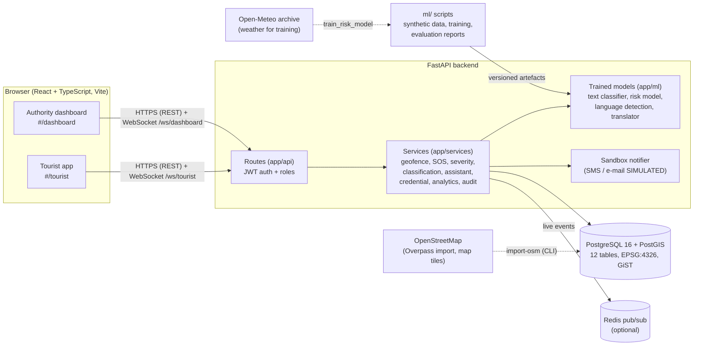

# TSMIRP — Tourist Safety Monitoring and Incident Response Platform

B.Tech final-year prototype for Smart India Hackathon problem statement **SIH25002**.

> **Decision support only.** TSMIRP is not a replacement for police or emergency services.
> In a real emergency, call **112**. Tourist helpline: **1363**.

All nine phases (0-9) are complete. The demo area is Jaipur.

## Architecture



More detail and every design assumption: [docs/architecture.md](docs/architecture.md).
Privacy rules: [docs/privacy.md](docs/privacy.md). Security checks: [docs/security.md](docs/security.md).

## Features

**Accounts and privacy**
- Argon2id password hashing; JWT access (15 min) and refresh (7 days) tokens; roles tourist,
  operator, supervisor, administrator. Public sign-up creates tourists only.
- Location only after explicit, revocable consent (off by default). Revoking deletes the
  stored location at once. Staff see a tourist's location only with consent or during an
  active SOS, and every view is audited.
- Stored locations expire after 30 days (configurable); `python -m app.cli purge-expired`
  deletes expired ones for good (run it daily).
- Hash-chained audit log of sensitive actions, with a verification endpoint.

**Incidents and the live dashboard**
- 9 categories with a suggested department; status lifecycle NEW -> ACKNOWLEDGED -> ASSIGNED ->
  EN_ROUTE -> RESOLVED -> CLOSED enforced by the API; live updates over WebSockets.
- Automatic category suggestion (TF-IDF + logistic regression, calibrated confidence; low
  confidence goes to human review) and explainable severity rules. Operators can override
  both; every override is audited.
- Reports in English, Hindi or romanised Hindi: the language is detected and Hindi is
  translated to English by a simple word list (behind a `Translator` interface) before
  classification.

**SOS and response**
- SOS with a 5-second cancel window -> CRITICAL incident -> live dashboard banner -> sandbox
  notifications to emergency contacts -> nearest resources -> operator assigns (simulated).
- Police stations, hospitals and fire stations imported from OpenStreetMap; nearest search with
  PostGIS KNN, cross-checked against a brute-force Haversine calculation in tests.

**Risk zones and geofencing**
- Hand-drawn synthetic demo zones plus ~1 km grid cells whose level comes from the risk model
  (per 6-hour period). Geofence alerts only for HIGH / CRITICAL, after a dwell time, with a
  cooldown. Levels are relative decision-support estimates, not crime predictions.

**Assistant, digital ID, analytics**
- Safety assistant: answers from a fixed, hand-written list of topics; always shows 112 and
  1363; a test makes sure no other phone number appears.
- Digital tourist ID: a signed, time-limited credential shown as a QR code (replaces the
  blockchain ID of the problem statement, which is out of scope). Staff can check it is
  genuine and not expired.
- Dashboard analytics: plain counts by status, severity, category, language and day.

## Machine learning (all on SYNTHETIC data)

| Command (from the repository root) | Report |
|---|---|
| `python -m ml.train_text_classifier` | [ml/reports/text_classifier.md](ml/reports/text_classifier.md) |
| `python -m ml.evaluate_multilingual` | [ml/reports/multilingual.md](ml/reports/multilingual.md) |
| `python -m ml.train_risk_model` | [ml/reports/risk_model.md](ml/reports/risk_model.md) |

Fixed seeds: the same command gives the same model version and the same numbers. The reports
include baselines, the development history (including runs that did worse than the baseline)
and known limitations. **These numbers do not show real-world accuracy.** Details:
[ml/README.md](ml/README.md).

## What is simulated

| Part | What really happens | What does NOT happen |
|---|---|---|
| Emergency dispatch ("assign") | The decision is stored and audited; the resource is marked BUSY (simulated) | No police, ambulance or fire service is contacted |
| SMS to emergency contacts, e-mail to the tourist | A sandbox row in `notifications` and a log line with masked numbers | Nothing is sent to any phone or mailbox (`app/services/notifier.py` has no real provider) |
| Resource availability (AVAILABLE / BUSY) | Simulated status in the database | Not linked to any real unit |
| Risk zones (demo) and risk model | Synthetic hotspots and synthetic incidents | No real crime data; never trained on arrests or enforcement data |
| Incident texts for the classifier | Synthetic template sentences | No real tourist reports |
| "Demo position" in the tourist app | A fake GPS fix at a Jaipur landmark, for testing anywhere | Not your real location |
| Digital tourist ID | A signed JWT shown as a QR code; checked by pasting its text | No blockchain, no camera scanning |
| Real data used | OpenStreetMap places (ODbL), Open-Meteo weather (training only), map tiles | — |

## Not done (out of scope for this prototype)
- **Load test**: not carried out, so no throughput or response-time figures are claimed.
- **PWA** (installable offline app): not built; the frontend is a normal web app.
- Blockchain digital ID: replaced by the signed QR credential (see above).
- Real translation model: the word list covers the demo vocabulary only.
- Credential revocation list: a credential stays valid until it expires unless the account is
  deactivated.

## Endpoints
All endpoints need a login except `/health` and `/auth/register|login|refresh` (a test checks
every documented endpoint). Interactive documentation: http://localhost:8000/docs

| Method | Path | Who |
|---|---|---|
| GET | /health | anyone |
| POST | /auth/register, /auth/login, /auth/refresh | anyone (login is rate-limited) |
| GET | /auth/me | any logged-in user |
| GET, PUT | /tourist/profile | tourist (own profile only) |
| PUT | /tourist/consent | tourist |
| GET, POST | /tourist/emergency-contacts | tourist (own contacts only) |
| DELETE | /tourist/emergency-contacts/{id} | tourist (own contacts only) |
| POST | /tourist/location | tourist (consent required) |
| GET | /tourist/notifications | tourist (own only) |
| GET | /tourist/credential | tourist (digital ID + QR code) |
| GET | /tourist/location/{user_id} | staff (consent or active SOS; audited) |
| POST | /credential/verify | staff (audited) |
| POST | /admin/users | administrator |
| GET | /audit-logs, /audit-logs/verify | supervisor, administrator |
| GET | /incident-categories | any logged-in user |
| POST | /incidents | tourist |
| GET | /incidents, /incidents/{id} | tourist (own only), staff (all) |
| PATCH | /incidents/{id}/status | staff |
| PATCH | /incidents/{id} | staff (override category / severity) |
| POST | /incident/classify | any logged-in user (rate-limited; 503 if no model trained) |
| POST | /sos | tourist (rate-limited) |
| POST | /sos/{id}/cancel | tourist (own SOS only) |
| GET | /nearby-resources?lat=&lon=&type=&k= | any logged-in user |
| GET | /incidents/{id}/recommended-resources | staff |
| POST | /incidents/{id}/assign | staff (simulated dispatch) |
| GET | /risk-zone?bbox=minLon,minLat,maxLon,maxLat | any logged-in user (GeoJSON) |
| POST | /risk/predict | staff (503 if no model trained) |
| POST | /assistant/query | any logged-in user |
| GET | /analytics/summary?days=7 | staff |
| WS | /ws/dashboard | staff (token sent in first message) |
| WS | /ws/tourist | tourist (own incidents only; token sent in first message) |

"Staff" = operator, supervisor or administrator.

## Run locally on Windows (no Docker)

Requirements: PostgreSQL 16 with PostGIS, Python 3.11+, Node 22. Redis is optional (without
it, live events stay inside one API process, which is fine for a demo).

1. Create a database named `tsmirp` (for example in pgAdmin).
2. Copy `.env.example` to `.env`, put your PostgreSQL password in it, and set `JWT_SECRET`
   to a long random value (the command to generate one is in the file).
3. Backend (from the `backend` folder):
   ```
   python -m venv .venv
   .venv\Scripts\activate
   pip install -e ".[dev]"
   alembic upgrade head
   python -m app.cli create-admin --email you@example.org --name "Your Name"
   python -m app.cli import-osm --area jaipur
   python -m app.cli seed-zones
   cd .. && python -m ml.train_text_classifier && python -m ml.evaluate_multilingual && python -m ml.train_risk_model && cd backend
   python -m app.cli predict-risk
   uvicorn app.main:app --reload
   ```
   `create-admin` asks for the password without showing it. Run it once.
   Open http://localhost:8000/health and http://localhost:8000/docs
4. Tests (from `backend`, with the venv active): `pytest -v`
5. Frontend (from the `frontend` folder):
   ```
   npm install
   npm run dev
   ```
   Open http://localhost:5173 and choose the tourist app or the authority dashboard.
6. Daily clean-up of expired locations (e.g. Windows Task Scheduler): `python -m app.cli purge-expired`

## Run with Docker (optional)
```
docker compose up --build
```
The containerised database is exposed on port 5433 so it does not clash with a local PostgreSQL.

## Known data limitations
- OpenStreetMap coverage is uneven: the Jaipur import (2026-10-08) found 403 "hospitals",
  22 police stations and 1 fire station; some "hospitals" are clinics and some stations appear
  twice. The data is used as-is.
- All distances are straight-line approximations; real road distance is longer.

## Data attribution
Map data and imported police / hospital / fire-station locations: © OpenStreetMap
contributors, available under the Open Database License (ODbL).
https://www.openstreetmap.org/copyright. Weather: Open-Meteo (https://open-meteo.com), CC BY 4.0.

## Repository layout
- `backend/` — FastAPI app (`app/api`, `core`, `models`, `schemas`, `services`, `ml`),
  Alembic migrations, tests
- `frontend/` — React + TypeScript (`src/tourist`, `src/dashboard`, `src/shared`)
- `ml/` — synthetic data generation, training, evaluation, reports
- `docs/` — architecture, privacy and security notes
